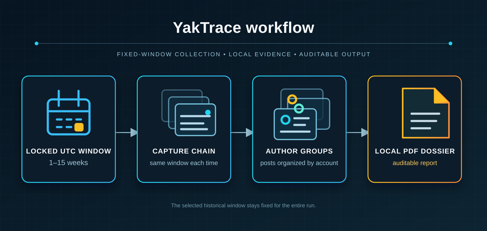

# YakTrace

**YakTrace (Yikstein files)** is a local YikYak research tool for collecting a fixed historical feed window, observing how that window changes after a source-level hide action, and rendering the resulting observational differences as a PDF dossier that groups every authors posts from the selected timeframe together. which deanonymizes authorship for a given school on a mass scale. It is built as a complete, self-contained release: the custom workflow, local connector, documentation, examples, and package lockfile all live in this repository.

> **PSA — about the name.** “Yikstein files” is the informal YikYak/Epstein nickname for this project. The nickname is a bit disrespectful, and the full Epstein files should be released. The official release is named **YakTrace**, and this repository includes the complete source files for it. YakTrace is not a YikYak product, feature, endorsement, or statement by YikYak or its operators.

YikYak's [FAQ](https://yikyak.com/faq) says that a user's name, phone number, and email are not shown to other users and states, “Nobody on the app can track who you are.” YakTrace documents a narrower but still serious problem: if source-level hiding changes which posts an account can retrieve, posts that disappear together can be grouped as likely coming from the same anonymous account. In a small community, that grouping can make someone easier to recognize, target, or infer from context.

The consequence is that the affected account is no longer anonymous in the practical sense users expect: its separate posts can be assembled into one persistent author-level record. Details that are harmless in isolation—where someone was, a class or workplace reference, a relationship, a writing habit, or a time pattern—can be combined across that record to track the same person through the group and potentially connect the account to an offline identity. Running YakTrace makes that correlation visible; it should be treated as a transparency and safety issue, not as permission to harass or target people.

## Contents

- [What it does](#what-it-does)
- [How the workflow works](#how-the-workflow-works)
- [Dossier and User-001](#dossier-and-user-001)
- [Install and run](#install-and-run)
- [Command reference](#command-reference)
- [Files, data, and output](#files-data-and-output)
- [Documentation](#documentation)
- [Credit](#credit)

## What it does

YakTrace is a repeatable evidence workflow for a YikYak group. It turns one selected historical window into a baseline, an ordered chain of snapshot differences, a transparent self-post section, and a PDF dossier. A capture does the following:

1. Authenticates a YikYak account and chooses one of its available groups.
2. Lets the operator select and then locks a 1-15-week UTC window at the beginning of the run.
3. Retrieves every reachable `recent` feed page in that same window and stores a baseline snapshot.
4. Hides the source selected by the next eligible visible post, then collects the exact same window again.
5. Repeats the comparison until no eligible non-self posts remain.
6. Clears the temporary hidden-source state, saves a final capture of the operator account's own posts, and generates a PDF dossier.

The important result is the difference between two consecutive snapshots. If a post exists in the parent snapshot but not in its child snapshot immediately after a source is hidden, YakTrace places that observation in the associated report unit. See the [exploit write-up](<docs/exploit writeup.md>) for the data model, assumptions, and failure modes behind that statement.

## How the workflow works



> **Workflow map.** The capture window is locked before the baseline is collected; every later capture uses that same historical period before the local dossier is produced.

The selected timeframe is locked before the baseline is collected: every snapshot uses the same fixed UTC start and end time. Posts made after the run begins are outside that locked window and are not counted in the dossier. YakTrace also records cursor progress, applies request pacing, retries rate-limit responses with backoff, and stops if a hide action does not actually remove its triggering post from the next capture.

### What YakTrace records

| Record | Why it exists |
| --- | --- |
| Snapshot metadata | Preserves the locked window, parent/child relationship, cursor, status, and collection counts. |
| Post IDs and metadata | Makes the parent/child set difference reviewable instead of relying on display text alone. |
| Raw feed responses | Allows the normalized record set to be checked against the returned pages. |
| Final self-post snapshot | Produces the report's transparent first unit: User-001. |

The output is an auditable grouped-feed observation for one authenticated account and one locked capture window.

## Dossier and User-001

YakTrace writes a finished PDF dossier only after the capture chain completes. Its cover identifies the group and the fixed UTC window shared by every report unit.


> **Figure 1 — Dossier cover.** The capture window makes clear that every unit is based on the same historical period—not a rolling live feed.

### Reading a report

| Section | Contents |
| --- | --- |
| `User-001` | The final same-window capture of posts authored by the account logged into YakTrace. |
| `User-002` and later | Posts present in a parent snapshot and absent from the next snapshot after a source-hide action. |
| Each post entry | Server post ID, UTC timestamp, upvote count, and preserved post text. |

If a report is generated, the user logged into the program making that report is listed as **User-001**. That first unit contains the final same-window capture limited to posts where YikYak marks `authored_by_user` as true. Later units contain post groups removed by the source-hide comparisons.

> “You cannot demand transparency without being the first to fall on your sword.”

This is deliberate: the dossier discloses the operator account’s own posts before it presents the observed groupings of anyone else’s content.

### Example grouped post

Each entry retains enough information to audit where it came from in the snapshot chain.


> **Figure 2 — Example dossier entry.** Post ID, UTC time, vote count, and post body are retained alongside the report unit that contains the observation.

## Install and run

### Requirements

- Node.js **22.13 or newer**; YakTrace uses Node's built-in SQLite module.
- A YikYak account authorized to access the selected group.
- Local disk space for the SQLite working database and generated PDF.

### Quick start

```bash
cd YakTrace
npm install
npm run yaktrace -- help
```

Authenticate first if needed, inspect accessible groups, then start a capture:

```bash
npm run yaktrace -- login
npm run yaktrace -- groups
npm run yaktrace -- capture
```

`capture` starts at **1 week** and presents an ↑/↓ selector that caps at **15 weeks**. Press Enter to lock the selected most-recent window. For scripting, skip the selector with `--weeks`:

```bash
npm run yaktrace -- capture --weeks 6
```


> **Figure 3 — Capture session.** The terminal reports the locked window, current iteration, remaining candidate posts, rate-limit waits, and generated dossier path.

## Command reference

Run all commands from `YakTrace/`.

| Command | Use |
| --- | --- |
| `npm run yaktrace -- help` | Print available commands and options. |
| `npm run yaktrace -- login` | Complete SMS authentication and save the local session token. |
| `npm run yaktrace -- groups` | List the authenticated account's available group IDs. |
| `npm run yaktrace -- capture` | Select a 1-15-week window and start a fresh capture for the first returned group. |
| `npm run yaktrace -- capture --group GROUP_ID` | Start a fresh capture for a specific group. |
| `npm run yaktrace -- capture --relogin` | Force a new SMS login before capturing. |
| `npm run yaktrace -- capture --weeks 6` | Skip the selector and capture the most recent six weeks. |

`--database path/to/file.sqlite` can be appended to any command to choose a different local database location. The default request ceiling is ten requests per second; set `YIKSTEIN_REQUESTS_PER_SECOND` to a lower positive value if the service is throttling heavily.

## Files, data, and output

A fresh release starts with the complete source, documentation and its figures, connector runtime, and lockfile. Captures, tokens, databases, reports, and installed dependencies are created locally when needed and remain outside the release tree.

```text
.
├── README.md                 # This project guide
├── YakTrace/                 # Custom CLI, package manifest, and lockfile
│   ├── src/                  # Capture, storage, report, and CLI modules
│   └── .runtime/             # Created locally at runtime; ignored by Git
├── sidechat.js/              # Isolated upstream YikYak API connector project
└── docs/                     # Usage guide, technical write-up, and figures
    └── images/               # README figures
```

At runtime, YakTrace creates the following local-only files beneath `YakTrace/.runtime/` unless you pass `--database`:

| Path | Contents |
| --- | --- |
| `yaktrace.sqlite` | Local bearer token, snapshots, normalized posts, and raw feed responses. |
| `reports/<group>-report.pdf` | Generated dossier for the selected group. |

The runtime directory is ignored by Git. It contains sensitive working data and is excluded from the release on purpose.

## Boundaries and limitations

- Each author group contains the posts made by the YikYak account selected through the source-hide action. That grouping holds unless a post is deleted during the run or the author blocks the logged-in account mid-run, which makes posts disappear for a separate reason.
- The run can take a long time for active groups because it captures the same window after each hide action and waits through rate limits.
- A capture can resume from stored cursor state after an interruption, but concurrent runs against the same account or database are not a good idea.

For the full technical explanation—including the set-difference model, SQL-backed evidence chain, and what would break the oracle—read the [exploit write-up](<docs/exploit writeup.md>).

## Documentation

- [How to use YakTrace](<docs/how to use YakTrace.md>) — setup, commands, local files, and troubleshooting.
- [Exploit write-up](<docs/exploit writeup.md>) — mechanism, snapshot model, persistence, controls, assumptions, and errors.

## Credit

Respect to **Micah Lindley**, the OG creator of the revered [`sidechat.js`](https://github.com/micahlt/sidechat.js) API project that makes this research build possible. YakTrace keeps that upstream connector isolated in `sidechat.js/` and keeps all project-specific logic in `YakTrace/`.
